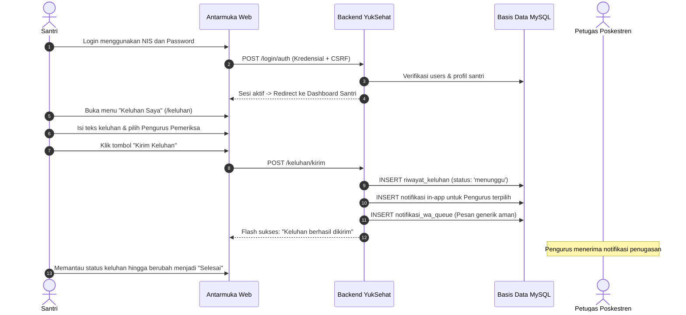
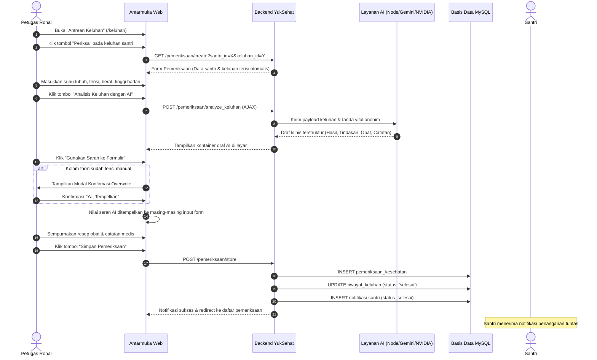
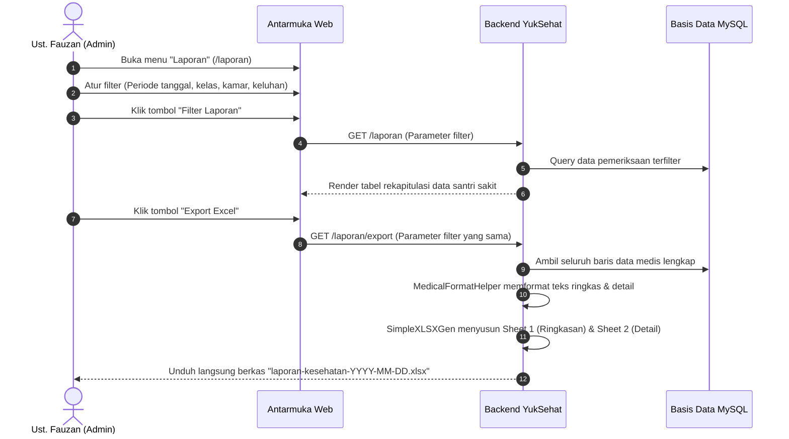

# PRODUCT REQUIREMENTS DOCUMENT (PRD)
# YUKSEHAT — SISTEM INFORMASI KESEHATAN SANTRI

- **Nama Produk:** YukSehat
- **Versi Produk:** 1.0.0
- **Status Dokumen:** Baseline Resmi (Berdasarkan Implementasi Nyata)
- **Tanggal Rilis Dokumen:** 16 November 2026
- **Klasifikasi Dokumen:** Dokumen Spesifikasi Produk Perangkat Lunak
- **Pemilik Produk (Product Owner):** Tim Pengembang Sistem Informasi Poskestren YukSehat

---

## 1. Identitas Produk

| Parameter | Keterangan |
|---|---|
| **Nama Aplikasi** | **YukSehat** |
| **Deskripsi Singkat** | Sistem Informasi Data dan Layanan Kesehatan Santri Berbasis Web untuk Pos Kesehatan Pesantren (Poskestren). |
| **Kategori Perangkat Lunak** | *Health Information System (HIS)* skala mikro / *School Health Management System*. |
| **Arsitektur Utama** | Monolitik MVC Murni (*Model-View-Controller*) berbasis Native PHP 8.1+ dan MySQL/MariaDB. |
| **Layanan Pendukung** | Mikrolayanan *Node.js* (Port 3005) untuk asisten konsultasi AI dan API WhatsApp Gateway (*Fonnte*). |
| **Target Lingkungan** | Web Browser modern (Desktop, Tablet, dan Ponsel Pintar). |
| **Bahasa Utama Antarmuka** | Bahasa Indonesia (Formal & Kontekstual Pesantren). |

---

## 2. Latar Belakang

Pondok pesantren sebagai lembaga pendidikan berbasis asrama (*boarding school*) menampung ratusan hingga ribuan santri yang tinggal dan beraktivitas bersama selama 24 jam sehari. Pola kehidupan komunal ini menempatkan santri pada risiko penularan penyakit menular yang tinggi, seperti skabies, influenza, infeksi saluran pernapasan akut (ISPA), demam berdarah, serta masalah pencernaan dan kebersihan pribadi (PHBS).

Mayoritas Pos Kesehatan Pesantren (Poskestren) masih mengandalkan pencatatan berbasis kertas (*paper-based ledger*). Praktik konvensional ini memicu berbagai kendala operasional:
1. Buku rekam medis fisik rentan hilang, rusak, dan sulit ditelusuri riwayatnya saat santri mengalami sakit berulang.
2. Santri yang merasa sakit seringkali enggan atau terlambat melapor ke pengurus karena rasa malu atau antrean manual yang tidak pasti.
3. Petugas Poskestren mengalami kesulitan mengidentifikasi tren penularan penyakit di asrama atau kamar tertentu secara cepat.
4. Laporan kesehatan berkala yang diminta oleh pimpinan pesantren atau dinas kesehatan membutuhkan waktu rekapitulasi manual yang lama dan rentan salah hitung.
5. Kurangnya media edukasi kesehatan preventif yang dapat diakses santri kapan saja secara aman dan terpercaya di lingkungan asrama.

Hadirnya **YukSehat** bertujuan menjawab kesenjangan tersebut melalui digitalisasi pencatatan rekam medis yang aman, transparan, terintegrasi dengan kecerdasan buatan (*AI Assistance*), serta didukung notifikasi otomatis dan tata kelola berbasis peran (*Role-Based Access Control*).

---

## 3. Permasalahan Pengguna (User Pain Points)

### A. Santri
1. **Hambatan Pelaporan**: Sulit menyampaikan keluhan kesehatan karena keterbatasan waktu operasional posko atau rasa enggan bertatap muka langsung saat gejala awal timbul.
2. **Ketidakpastian Penanganan**: Tidak mengetahui apakah keluhan yang dilaporkan sudah dilihat atau kapan petugas kesehatan akan memeriksa.
3. **Ketiadaan Riwayat Pribadi**: Santri tidak memiliki akses mudah untuk melihat riwayat alergi, obat yang pernah diberikan, dan hasil pemeriksaan sebelumnya.
4. **Kekurangan Informasi Medis Tepercaya**: Kesulitan mendapatkan edukasi awal mengenai keluhan penyakit ringan sehari-hari di asrama.

### B. Pengurus Poskestren / Petugas Kesehatan
1. **Beban Administrasi Manual**: Menghabiskan waktu mencatat data vital dan menulis resep di buku rekam medis yang terpisah-pisah.
2. **Keterbatasan Triase Cepat**: Membutuhkan bahan pertimbangan awal (*second opinion*) yang ringkas saat menyusun catatan klinis santri tanpa harus membuka buku teks tebal.
3. **Penugasan Pasien Tidak Teratur**: Koordinasi pembagian santri yang sakit antar-petugas jaga sering tumpang-tindih.
4. **Penyusunan Laporan Melelahkan**: Menghitung manual jumlah santri rawat inap, santri sakit per kamar, atau santri yang memerlukan rujukan ke rumah sakit luar.

### C. Pimpinan Pondok Pesantren / Administrator Sistem
1. **Ketiadaan Visibilitas Real-Time**: Tidak memiliki data akurat terkait kondisi kesehatan santri harian di tiap asrama.
2. **Risiko Kebocoran Data Sensitif**: Kekhawatiran atas privasi data rekam medis santri jika disalahgunakan oleh pihak yang tidak berhak.
3. **Keterbatasan Evaluasi Program Kesehatan**: Sulit merancang kebijakan sanitasi dan PHBS karena ketiadaan rekapitulasi data tren keluhan penyakit terbanyak.

---

## 4. Tujuan Produk (Product Goals)

1. **Efisiensi Pencatatan Medis**: Memangkas waktu pencatatan rekam medis fisik santri dari rata-rata manual menjadi tersimpan digital terpusat dalam hitungan detik.
2. **Transparansi Alur Keluhan**: Memfasilitasi santri untuk mengajukan keluhan dan memantau status penanganannya secara *real-time* dari status Menunggu, Diperiksa, hingga Selesai.
3. **Peningkatan Kualitas Keputusan Klinis**: Menyediakan draf asisten klinis cerdas berbasis AI yang memberikan rangkuman terstruktur keluhan santri dan data vital sebagai bahan pertimbangan petugas kesehatan.
4. **Otomatisasi Pelaporan**: Menyediakan ekspor rekapitulasi kesehatan multi-sheet ke format Microsoft Excel (.xlsx) dengan pemformatan medis profesional dalam satu klik.
5. **Keamanan & Kepatuhan Privasi**: Menerapkan tata kelola akses data medis ketat sesuai peran (Admin, Pengurus, Santri) dengan standar keamanan anti-SQL Injection, anti-CSRF, dan pencegahan kebocoran data medis ke saluran komunikasi publik.

---

## 5. Visi Produk (Product Vision)

> *"Menjadi platform tata kelola kesehatan pesantren terdepan yang memadukan keandalan sistem rekam medis digital dengan kecerdasan buatan, guna menciptakan lingkungan pondok pesantren yang sehat, tanggap, aman, dan berdaya saing tinggi."*

---

## 6. Target Pengguna dan Persona

YukSehat melayani tiga kelompok pengguna utama:

### Persona 1: Administrator Sistem (Super User)
- **Nama Representatif**: Ust. Fauzan (34 tahun)
- **Peran**: Kepala Tata Usaha & Administrator Teknologi Pesantren
- **Karakteristik**: Teliti, menguasai operasional komputer dasar, bertanggung jawab atas keamanan data santri dan tata kelola akun staf.
- **Tujuan**: Memantau statistik kesehatan pesantren secara makro, mengelola akun pengurus, mengatur model AI yang aktif, dan memantau konektivitas gateway WhatsApp.
- **Tantangan**: Memerlukan antarmuka ringkas tanpa konfigurasi teknis yang membingungkan.

### Persona 2: Pengurus Poskestren / Petugas Kesehatan
- **Nama Representatif**: Petugas Ronal (27 tahun)
- **Peran**: Penanggung Jawab Pos Kesehatan Pesantren (Poskestren)
- **Karakteristik**: Memiliki latar belakang paramedis/kesehatan pesantren, bekerja cepat di lapangan, menangani santri sakit setiap hari.
- **Tujuan**: Meninjau antrean keluhan santri yang masuk, melakukan pemeriksaan fisik vital, memanfaatkan draf AI untuk mempercepat penulisan diagnosa/tindakan, dan mencatat resep obat.
- **Tantangan**: Tidak ingin terbebani form yang rumit saat melayani santri yang sedang mengantre di posko.

### Persona 3: Santri Pondok Pesantren
- **Nama Representatif**: Budi Santoso (16 tahun, Kelas X IPA)
- **Peran**: Santri Asrama
- **Karakteristik**: Terbiasa menggunakan gawai pintar, tinggal di kamar asrama komunal, membutuhkan penanganan cepat saat merasa tidak enak badan.
- **Tujuan**: Melaporkan sakit ke Poskestren tanpa rasa cemas, memilih petugas yang sedang bertugas, memantau riwayat pemeriksaannya, dan bertanya seputar kesehatan ringan pada chatbot AI.
- **Tantangan**: Membutuhkan antarmuka yang ramah, tidak kaku, dan mudah diakses melalui peramban web ponsel.

---

## 7. Kebutuhan Pengguna (User Needs)

| ID Kebutuhan | Peran | Kebutuhan Utama (*Need Statement*) |
|---|---|---|
| **UN-01** | Santri | Membutuhkan formulir daring untuk menyampaikan keluhan kesehatan dan memilih petugas pemeriksa. |
| **UN-02** | Santri | Membutuhkan informasi kejelasan status keluhan (apakah sedang menunggu antrean, diproses, atau selesai). |
| **UN-03** | Santri | Membutuhkan akses mandiri untuk melihat riwayat rekam medis pribadinya secara rahasia. |
| **UN-04** | Santri | Membutuhkan wadah konsultasi interaktif 24 jam untuk menanyakan gejala ringan dan edukasi hidup bersih sehat. |
| **UN-05** | Pengurus | Membutuhkan daftar antrean keluhan santri terpusat dengan filter status dan indikator jumlah laporan. |
| **UN-06** | Pengurus (Ronal) | Membutuhkan formulir pencatatan pemeriksaan tanda vital (suhu, tensi, berat, tinggi), diagnosa, tindakan, dan obat. |
| **UN-07** | Pengurus | Membutuhkan asisten kecerdasan buatan untuk menganalisis keluhan dan tanda vital santri secara ringkas. |
| **UN-08** | Pengurus | Membutuhkan notifikasi in-app saat ada keluhan baru masuk atau santri memilih dirinya sebagai pemeriksa. |
| **UN-09** | Pengurus & Admin | Membutuhkan filter laporan kesehatan santri (berdasarkan kelas, kamar, periode) dan fitur ekspor ke Excel (.xlsx). |
| **UN-10** | Admin | Membutuhkan dashboard statistik kesehatan real-time (jumlah santri sakit, rawat inap/UKS, rujukan rumah sakit). |
| **UN-11** | Admin | Membutuhkan modul manajemen pengguna (tambah akun, ganti role, nonaktifkan akun, update nomor WhatsApp). |
| **UN-12** | Admin | Membutuhkan halaman konfigurasi model AI (NVIDIA NIM & Google Gemini) dan pengujian latensi model. |
| **UN-13** | Admin | Membutuhkan dashboard pemantauan antrean notifikasi WhatsApp dan audit koneksi perangkat ke gateway Fonnte. |

---

## 8. Solusi yang Ditawarkan

1. **Digital Queue & Triage Poskestren**: Menggantikan buku antrean fisik dengan antrean interaktif berbasis status (`menunggu`, `diperiksa`, `selesai`) yang terhubung langsung dengan akun santri dan notifikasi in-app.
2. **Electronic Health Records (EHR) Khusus Pesantren**: Rekam medis komprehensif yang mencakup biodata asrama (kamar, kelas), data vital fisik, diagnosa, tindakan, obat, dan catatan tanda bahaya klinis.
3. **AI Clinical Assistant (Dual-Engine: NVIDIA & Gemini)**: Fitur penganalisis keluhan medis terintegrasi yang menghasilkan draf saran awal 1–2 butir poin per bagian, dilengkapi peringatan etika kedokteran (*non-diagnostic disclaimer*).
4. **Smart AI Health Chatbot**: Widget mengambang (*floating widget*) cerdas yang mampu menjawab konsultasi kesehatan santri sekaligus melayani pertanyaan analitik data operasional bagi staf terautentikasi (contoh: *"Berapa pemeriksaan hari ini?"*).
5. **Multi-Sheet Professional Excel Generator**: Mesin rekapitulasi yang menghasilkan berkas Excel berisikan Ringkasan Laporan siap pakai pada Sheet 1 dan Catatan Klinis Lengkap pada Sheet 2 tanpa pustaka eksternal yang membebani server.
6. **Safe-Mode Controlled WhatsApp Gateway**: Integrasi antrean WhatsApp asinkron yang menerapkan proteksi privasi medis mutlak (*Zero Medical Data on WhatsApp*) dan mekanisme idempotensi pencegah pesan berulang.

---

## 9. Ruang Lingkup Produk (Product Scope)

### Di Dalam Ruang Lingkup (In-Scope):
- Autentikasi pengguna berbasis sesi aman (Login dengan Username, NIS, atau Nama Petugas, serta Registrasi Santri).
- Role-Based Access Control (RBAC) ketat untuk 3 peran: Administrator, Pengurus, dan Santri.
- Kebijakan penugasan khusus petugas pemeriksa (Aturan Khusus Petugas Ronal untuk form tambah periksa).
- Manajemen master data santri (CRUD, pencarian, filter kelas/kamar, paginasi, dan deaktivasi akun).
- Pengajuan keluhan santri dan antrean keluhan Poskestren real-time.
- Pencatatan rekam medis pemeriksaan kesehatan (Data fisik vital, diagnosa, tindakan, obat, catatan).
- Asisten AI penganalisis keluhan klinis terintegrasi ke form pemeriksaan dengan konfirmasi penimpaan data.
- Chatbot AI floating widget (pertanyaan deterministik, prescreening topik, data query real-time, dan konsultasi generatif).
- Pusat notifikasi in-app interaktif dengan modal rincian keluhan dan penandaan status baca AJAX.
- Laporan rekapitulasi kesehatan dan ekspor file spreadsheet Microsoft Excel (.xlsx) 2 sheet.
- Modul administrasi: Pengelolaan akun pengguna, penetapan role, dan nomor WhatsApp.
- Pengaturan model AI terpadu (NVIDIA NIM dan Google Gemini API) beserta pengujian latensi via AJAX.
- Modul pemantauan antrean pengiriman WhatsApp, audit log pengiriman, dan cek koneksi perangkat Fonnte.

### Di Luar Ruang Lingkup (Out-of-Scope):
- Pengunggahan berkas digital fisik (seperti foto rontgen, berkas PDF hasil lab eksternal, atau resep cetak scan).
- Modul pembayaran obat, kasir Poskestren, atau integrasi gateway pembayaran perbankan/fintech.
- Integrasi ke sistem BPJS Kesehatan atau platform SATUSEHAT Kementerian Kesehatan RI (belum tersedia pada versi 1.0).
- Diagnosa medis otonom tanpa supervisi manusia (AI dilarang keras menggantikan peran pemeriksa fisik).
- Otomasi pemesanan ambulans atau integrasi GPS darurat.

---

## 10. Fitur dan Deskripsi Fitur

Berikut adalah tabel rincian fitur produk berdasarkan ketersediaan aktual di kode sumber:

| Kode Fitur | Nama Fitur | Deskripsi Fungsional | Status Implementasi |
|---|---|---|:---:|
| **FEAT-01** | Autentikasi Multi-Identifier & Keamanan Sesi | Autentikasi menggunakan BCrypt, multi-login (Username/NIS/Nama), regenerasi ID sesi, dan rotasi CSRF token. | **Aktif** |
| **FEAT-02** | Registrasi Akun Santri Mandiri | Pendaftaran santri baru dengan validasi keunikan NIS dan username, serta verifikasi password minimal 8 karakter. | **Aktif** |
| **FEAT-03** | Dashboard Statistik Berbasis Peran | Visualisasi metrik total santri, santri sakit, pemeriksaan hari ini, rawat inap/UKS, dan rujukan luar disesuaikan per role. | **Aktif** |
| **FEAT-04** | Master Data Santri Terfilter | Direktori santri lengkap dengan pencarian nama/NIS, filter kelas/kamar, paginasi data, dan deaktivasi akun (*soft delete*). | **Aktif** |
| **FEAT-05** | Pengajuan Keluhan Santri | Form pelaporan sakit santri dengan pemilihan petugas pemeriksa Poskestren dan notifikasi otomatis ke petugas terpilih. | **Aktif** |
| **FEAT-06** | Antrean Keluhan & Penugasan Staf | Manajemen antrean keluhan santri terfilter tab (Semua, Menunggu, Diperiksa, Selesai), pengalihan penugasan, dan ubah status cepat. | **Aktif** |
| **FEAT-07** | Pencatatan Rekam Medis Fisik | Rekam medis vital lengkap (suhu, tensi, berat, tinggi), integrasi data keluhan otomatis, diagnosa, tindakan, dan obat. | **Aktif** |
| **FEAT-08** | Asisten AI Analisis Klinis | Fitur tombol "Analisis Keluhan dengan AI" yang menghasilkan draf klinis ringkas (1–2 poin per bagian) dan dapat ditempelkan ke form. | **Aktif** |
| **FEAT-09** | Modal Konfirmasi Penimpaan Data AI | Dialog konfirmasi interaktif saat menempelkan saran AI jika kolom form sudah berisi catatan manual pemeriksa. | **Aktif** |
| **FEAT-10** | Chatbot Poskestren Dual-Engine | Widget interaktif mengambang berdaya Google Gemini dan NVIDIA NIM, dengan aturan deterministik, filter off-topic, dan data query. | **Aktif** |
| **FEAT-11** | Chatbot Data Query Real-Time | Kemampuan chatbot menjawab pertanyaan statistik basis data operasional secara langsung untuk Admin dan Pengurus. | **Aktif** |
| **FEAT-12** | Pusat Notifikasi In-App & Modal Rincian | Riwayat notifikasi penugasan dan status keluhan, dilengkapi modal rincian interaktif dan penandaan baca instan tanpa reload. | **Aktif** |
| **FEAT-13** | Laporan Kesehatan & Ekspor Multi-Sheet | Rekapitulasi pemeriksaan medis terfilter dengan unduhan file XLSX 2 lembar kerja (Ringkasan dan Detail Catatan Klinis). | **Aktif** |
| **FEAT-14** | Pengelolaan Pengguna & Anti-Lockout | Manajemen akun admin dan pengurus, rotasi role, pembaruan nomor WhatsApp, dengan proteksi anti-lockout admin aktif. | **Aktif** |
| **FEAT-15** | Pengaturan AI & Manajemen API Key | Pilihan model AI instan, pengujian latensi via AJAX, penambahan kunci API baru, dan penghapusan kunci API aman. | **Aktif** |
| **FEAT-16** | Antrean Pengiriman Notifikasi WhatsApp | Integrasi gateway Fonnte via tabel antrean (`notifikasi_wa_queue`), atomic worker lock, exponential backoff, dan status F-01. | **Simulasi / Safe-Mode** (Tergantung Switch `WHATSAPP_ENABLED`) |
| **FEAT-17** | Monitoring Gateway WhatsApp Real-Time | Dashboard khusus admin untuk memantau kuota Fonnte, status perangkat, antrean tertahan, dan tombol rekonsiliasi manual. | **Aktif** |
| **FEAT-18** | Pembatasan Input Medis Petugas Ronal | Pembatasan hak akses form tambah rekam medis baru khusus untuk akun pengurus dengan username `ronal`. | **Parsial (Aturan Khusus)** |
| **FEAT-19** | Modul Kesehatan Statis | Rute `/kesehatan` yang hanya berisi placeholder tampilan sederhana. | **Placeholder** |

---

## 11. Prioritas Fitur (Metode MoSCoW)

### Must Have (Wajib Ada untuk Operasional Utama):
- [FEAT-01] Autentikasi Multi-Identifier & Keamanan Sesi.
- [FEAT-03] Dashboard Statistik Berbasis Peran.
- [FEAT-04] Master Data Santri Terfilter.
- [FEAT-05] Pengajuan Keluhan Santri.
- [FEAT-06] Antrean Keluhan & Penugasan Staf.
- [FEAT-07] Pencatatan Rekam Medis Fisik.
- [FEAT-12] Pusat Notifikasi In-App & Modal Rincian.
- [FEAT-13] Laporan Kesehatan & Ekspor Multi-Sheet.
- [FEAT-14] Pengelolaan Pengguna & Anti-Lockout.

### Should Have (Sangat Penting untuk Efisiensi & Kualitas Layanan):
- [FEAT-08] Asisten AI Analisis Klinis pada Form Pemeriksaan.
- [FEAT-09] Modal Konfirmasi Penimpaan Data AI.
- [FEAT-10] Chatbot Poskestren Dual-Engine (Konsultasi Kesehatan Santri).
- [FEAT-11] Chatbot Data Query Real-Time (Khusus Admin/Pengurus).
- [FEAT-15] Pengaturan AI & Manajemen API Key.
- [FEAT-18] Pembatasan Input Medis Khusus Petugas Ronal.

### Could Have (Nilai Tambah & Otomasi Eksternal):
- [FEAT-02] Registrasi Akun Santri Mandiri.
- [FEAT-16] Antrean Pengiriman Notifikasi WhatsApp (Live Delivery via Fonnte).
- [FEAT-17] Monitoring Gateway WhatsApp Real-Time.

### Won't Have (Tidak Disertakan pada Rilis v1.0.0):
- [FEAT-19] Modul Kesehatan Statis (digantikan fungsi terpadu di Keluhan & Pemeriksaan).
- Pengunggahan berkas rekam medis digital (foto rontgen/lab).
- Integrasi klaim asuransi / BPJS / SATUSEHAT.

---

## 12. Alur Pengguna (User Journey)

### A. User Journey: Santri Melaporkan Sakit

### B. User Journey: Petugas Pengurus (Ronal) Memeriksa Santri

### C. User Journey: Administrator Mengunduh Laporan Medis

---

## 13. User Stories dan Kriteria Penerimaan

| ID Story | Sebagai... (*Role*) | Saya ingin... (*Action*) | Sehingga... (*Benefit*) | Kriteria Penerimaan (*Acceptance Criteria*) |
|---|---|---|---|---|
| **US-01** | Santri | Mengirimkan keluhan kesehatan secara online dari kamar | Petugas Poskestren segera mengetahui kondisi saya tanpa harus menunggu jadwal kunjungan | - Validasi keluhan tidak boleh kosong. - Pilihan petugas pemeriksa wajib valid. - Tersimpan di tabel `riwayat_keluhan` dengan status `menunggu`. |
| **US-02** | Santri | Melihat riwayat hasil pemeriksaan medis saya | Saya mengetahui obat yang pernah diberikan dan saran pemulihan dari petugas | - Santri hanya dapat melihat rekam medis atas nama dirinya sendiri. - Upaya akses ID pemeriksaan santri lain menghasilkan pesan penolakan (*Anti-IDOR*). |
| **US-03** | Santri | Bertanya kepada asisten AI kesehatan melalui chatbot | Saya memperoleh edukasi kesehatan ringan kapan saja di lingkungan pondok | - Chatbot merespons topik kesehatan santri secara sopan. - Pertanyaan di luar kesehatan ditolak dengan pesan standar. - Disertai penafian (*disclaimer*) bukan pengganti periksa dokter. |
| **US-04** | Pengurus | Melihat seluruh antrean keluhan santri terpusat | Saya dapat memprioritaskan santri yang membutuhkan penanganan segera | - Tabel antrean menyajikan filter: Semua, Menunggu, Diperiksa, Selesai. - Menampilkan nama santri, NIS, kelas, kamar, dan nama pemeriksa. |
| **US-05** | Pengurus (Ronal) | Mengisi data tanda vital fisik dan catatan medis santri | Seluruh riwayat diagnosa dan terapi obat santri tercatat permanen secara digital | - Formulir mencakup input: suhu, tensi, berat, tinggi, diagnosa, tindakan, obat, catatan. - Akses dibatasi khusus akun pengurus berwenang (Ronal). |
| **US-06** | Pengurus | Memanfaatkan draf tinjauan klinis dari AI | Saya dapat menuliskan resume medis dan tindakan pertolongan pertama dengan lebih cepat | - Analisis AI merangkum keluhan dan tanda vital dalam waktu beberapa detik. - Data saran dapat disalin ke form dengan satu klik konfirmasi. |
| **US-07** | Pengurus | Menerima notifikasi in-app saat ada keluhan baru | Saya dapat segera menindaklanjuti santri yang memilih saya sebagai pemeriksa | - Badge notifikasi unread di navbar otomatis bertambah. - Tombol "Buka Rincian" memunculkan modal detail keluhan. |
| **US-08** | Admin | Mengunduh rekapitulasi data pemeriksaan ke format Excel | Saya dapat melaporkan berkala kondisi kesehatan santri ke pimpinan pondok | - Berkas XLSX terunduh otomatis memuat Sheet 1 (Ringkasan) dan Sheet 2 (Detail Catatan Medis). - Mendukung filter rentang tanggal dan kriteria asrama. |
| **US-09** | Admin | Mengubah peran (*role*) dan status pengguna | Akses operasional sistem dapat dikendalikan secara tertib | - Admin dapat mengubah role (Admin/Pengurus/Santri) dan status (Active/Inactive). - Akun Admin yang sedang login tidak dapat diturunkan role-nya sendiri (*Anti-Lockout*). |
| **US-10** | Admin | Mengganti model AI yang aktif (NVIDIA/Gemini) | Performa chatbot dan asisten klinis dapat disesuaikan tanpa perlu mengubah kode sumber | - Pilihan model tersimpan ke tabel `system_settings`. - Tersedia tombol uji koneksi dan latensi model via AJAX. |
| **US-11** | Admin | Memantau antrean pesan WhatsApp dan status gateway Fonnte | Saya mengetahui keandalan notifikasi eksternal tanpa risiko pengiriman data medis | - Tampilan metrik antrean: Pending, Processing, Sent, Failed, Reconciliation Required. - Tidak ada kebocoran token API atau pesan keluhan santri pada layar pemantauan. |

---

## 14. Aturan Bisnis (Business Rules)

Berikut adalah aturan bisnis baku yang ditegakkan oleh aplikasi YukSehat:

- **BR-001 (Kerahasiaan Rekam Medis)**: Rekam medis santri bersifat rahasia. Santri hanya diizinkan melihat rekam medis milik akunnya sendiri. Hak akses melihat seluruh rekam medis santri dibatasi hanya untuk peran Admin dan Pengurus.
- **BR-002 (Otorisasi Khusus Input Pemeriksaan)**: Hak membuka formulir penambahan rekam medis baru (`/pemeriksaan/create`) dan menyimpan rekam medis baru (`/pemeriksaan/store`) dibatasi khusus kepada petugas Pengurus yang ditunjuk secara resmi, yaitu akun dengan username `ronal` (`AuthHelper::canInputPemeriksaan()`). Akun lain hanya memiliki hak membaca, mengedit, atau menghapus data riwayat yang ada.
- **BR-003 (Siklus Status Keluhan)**: Keluhan santri baru selalu berstatus awal `menunggu`. Status berubah menjadi `diperiksa` saat petugas mulai menangani, dan berubah menjadi `selesai` secara otomatis saat pemeriksaan medis berhasil disimpan atau ditandai tuntas oleh pengurus.
- **BR-004 (Idempotensi Notifikasi)**: Sistem melarang pembuatan notifikasi duplikat untuk pengguna yang sama, jenis peristiwa yang sama, dan referensi objek keluhan yang sama.
- **BR-005 (Pemberitahuan Khusus Penugasan)**: Notifikasi keluhan baru hanya dikirimkan kepada pengurus yang dipilih atau ditugaskan secara eksplisit, bukan disiarkan (*broadcast*) ke seluruh pengurus. Notifikasi pembaruan status keluhan dikirimkan kembali ke akun santri pelapor.
- **BR-006 (Privasi Mutlak Kanal WhatsApp)**: Seluruh pesan yang dicatat pada antrean WhatsApp (`notifikasi_wa_queue`) dilarang keras memuat diagnosa, nama obat, tanda vital, atau narasi keluhan medis santri. Pesan WhatsApp wajib bersifat generik dan mengarahkan pengguna untuk masuk ke dalam aplikasi resmi.
- **BR-007 (Ketahanan Kegagalan Gateway)**: Kegagalan koneksi jaringan, kegagalan gateway WhatsApp (Fonnte), atau habisnya kuota token API dilarang membatalkan (*rollback*) transaksi penyimpanan notifikasi in-app dan rekam medis di basis data lokal.
- **BR-008 (Anti-Lockout Super User)**: Sistem menolak setiap upaya Admin untuk menonaktifkan status akunnya sendiri atau menurunkan perannya sendiri dari status Administrator aktif.
- **BR-009 (Etika Asisten AI Klinis)**: Saran yang dihasilkan oleh model AI (Google Gemini / NVIDIA NIM) berstatus sebagai draf bahan pertimbangan awal (*draft preliminary recommendation*), bukan diagnosa medis final atau resep otomatis. Keputusan akhir mutlak berada di bawah tanggung jawab petugas pemeriksa fisik.
- **BR-010 (Integritas Penghapusan Santri)**: Penghapusan santri dari menu `/santri/delete` menerapkan mekanisme deaktivasi status akun (*soft-delete* `status='inactive'`), sehingga integritas riwayat pemeriksaan masa lampau tetap terlindungi untuk audit medis.

---

## 15. Indikator Keberhasilan Produk (Success Metrics & KPIs)

| Kategori Metrik | Indikator Keberhasilan | Target yang Diharapkan |
|---|---|---|
| **Adopsi Pengguna** | Persentase santri yang melaporkan keluhan via aplikasi dibanding laporan verbal fisik. | >= 80% laporan tercatat digital di Poskestren. |
| **Kecepatan Layanan** | Waktu tunggu dari keluhan berstatus `menunggu` hingga `diperiksa`/`selesai`. | Rata-rata tindak lanjut di bawah 60 menit pada jam operasional posko. |
| **Efisiensi Input** | Waktu yang dibutuhkan petugas untuk merekam satu data pemeriksaan lengkap. | Di bawah 2 menit per santri (terbantu oleh prefill keluhan & draf AI). |
| **Integritas Medis** | Persentase keluhan yang memiliki rekam pemeriksaan terkait (*traceability*). | 100% keluhan tuntas memiliki catatan penanganan yang jelas. |
| **Keamanan Sistem** | Insiden kebocoran data medis santri pada log atau kanal eksternal. | **0 Insiden (Nol Pelanggaran Privasi)**. |
| **Kesiapan Ekspor** | Kecepatan unduh laporan rekapitulasi bulanan pesantren ke format Excel. | Di bawah 3 detik untuk rentang data bulanan normal. |

---

## 16. Asumsi dan Batasan Produk

### Asumsi:
1. Poskestren memiliki minimal 1 (satu) unit komputer/laptop yang terhubung ke jaringan lokal atau internet untuk operasional harian petugas pemeriksa.
2. Santri memiliki akses terjadwal ke gawai pintar, laboratorium komputer, atau posko konsultasi digital di pesantren untuk menyampaikan keluhan dan konsultasi AI.
3. Server lokal XAMPP atau cloud server memiliki ekstensi PHP wajib yang aktif: `pdo_mysql`, `curl`, `mbstring`, dan `openssl`.

### Batasan Teknis dan Operasional:
1. **Konektivitas Fitur AI**: Pemanggilan fitur Analisis Keluhan dan AI Chatbot generatif membutuhkan akses internet aktif untuk terhubung ke endpoint Google AI Studio atau NVIDIA NIM. Jika internet terputus, chatbot secara aman mengaktifkan fallback deterministik lokal dan pesan edukasi offline.
2. **Ketergantungan Port Mikrolayanan**: Server chatbot Node.js berjalan di lingkungan lokal pada port 3005 (`127.0.0.1:3005`). Jika layanan ini tidak diaktifkan, backend PHP otomatis menangani permintaan konsultasi melalui engine cURL internal PHP.
3. **Pengiriman WhatsApp**: Keberhasilan transmisi pesan WhatsApp sangat bergantung pada status koneksi perangkat pada gateway Fonnte, ketersediaan kuota paket, dan status nomor telepon penerima (format internasional `628xxx`).
4. **Kebijakan Akun Tunggal Input Pemeriksaan**: Sesuai aturan bisnis BR-002, form pembuatan pemeriksaan baru dikunci secara sistem untuk akun petugas `ronal`. Penambahan wewenang petugas baru memerlukan penyesuaian aturan pada modul `AuthHelper`.
