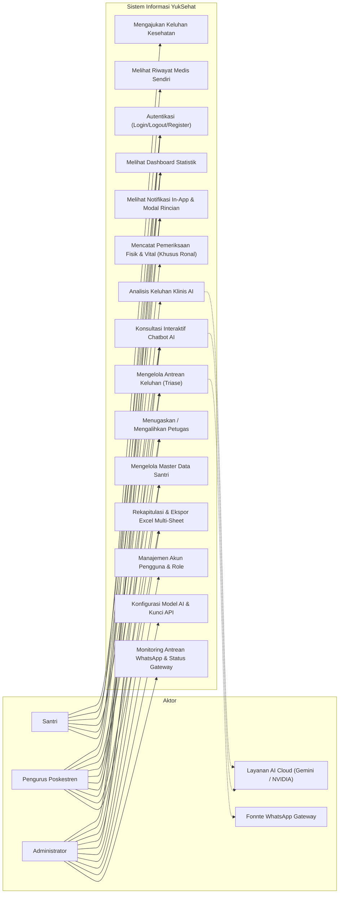
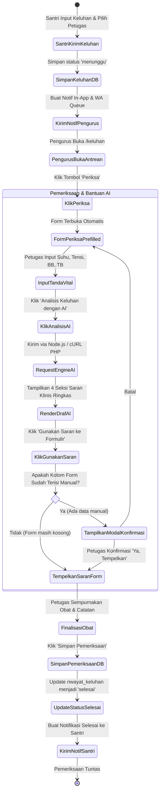
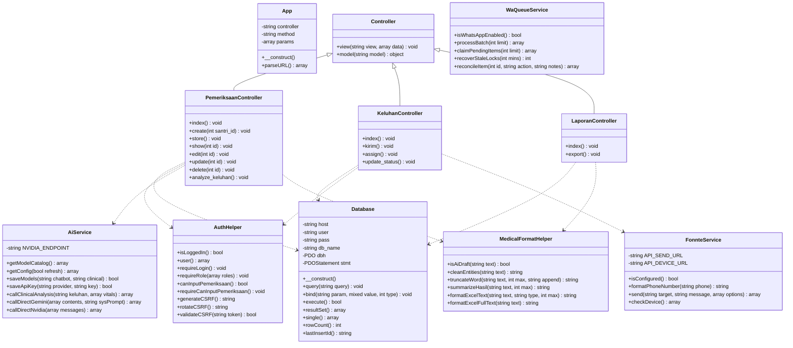
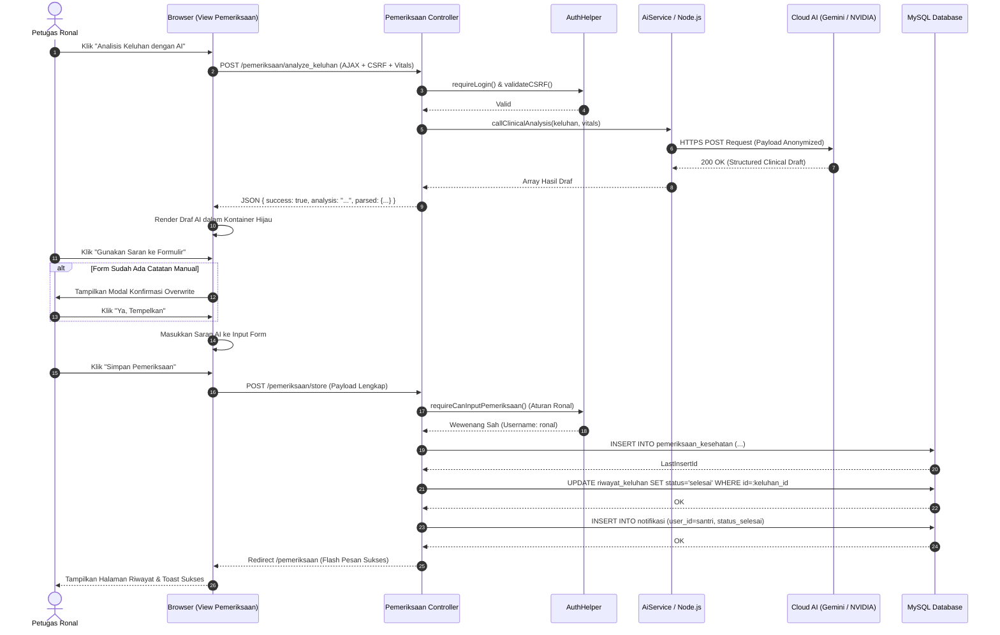
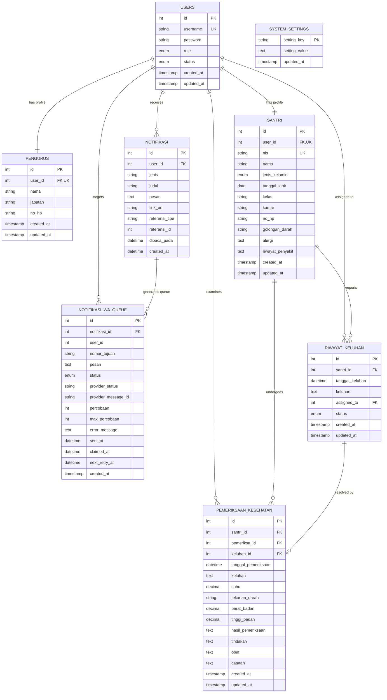

# DOKUMEN TAHAP 2: PERANCANGAN UML & ARSITEKTUR SISTEM MANDIRI (SDD)
**Mata Kuliah:** Rekayasa Perangkat Lunak (TIKB2503021) — 4 SKS (Semester 3)  
**Program Studi:** S1 Teknik Informatika — STMIK IKMI Cirebon  
**Dosen Pengampu:** Yudhistira Arie Wijaya, M.Kom., CDS.  
**Sifat Pengerjaan:** Mandiri / Perorangan (100% Individual Ownership & Full-App Build)  
**Tema Topik Kelompok:** *Smart Healthcare & Public Service AI*  
**Judul Aplikasi:** **YukSehat — Sistem Informasi Data & Layanan Kesehatan Santri Berbasis Web (Poskestren)**

---

## 1. Pendahuluan Arsitektur Sistem

Dokumen Perancangan Perangkat Lunak (*Software Design Document* - SDD) ini memvisualisasikan struktur statis dan perilaku dinamis sistem aplikasi **YukSehat** secara utuh. Perancangan mengadopsi prinsip **Clean Code & Object-Oriented Design (SOLID)** di atas pola arsitektur **Model-View-Controller (MVC)**.

Sistem memadukan komputasi monolitik PHP Native yang tangguh dan ringan dengan arsitektur mikrolayanan *Node.js* untuk orkestrasi asisten AI generatif.

---

## 2. Pemodelan 4 Diagram UML Utama

### 2.1 Use Case Diagram & Skenario Use Case

#### A. Use Case Diagram


#### B. Skenario Use Case Utama

##### Skenario Use Case 1: Pencatatan Pemeriksaan Medis dengan Bantuan AI (UC-06 & UC-07)
- **Aktor Utama**: Pengurus Poskestren Berwenang (Petugas Ronal).
- **Aktor Pendukung**: Google Gemini API / NVIDIA NIM API.
- **Kondisi Awal (Pre-condition)**: Petugas Ronal telah login dengan sesi aktif dan membuka halaman antrean keluhan santri.
- **Kondisi Akhir (Post-condition)**: Rekam medis tersimpan di tabel `pemeriksaan_kesehatan`, status keluhan menjadi `'selesai'`, dan santri menerima notifikasi in-app.
- **Alur Utama (Main Flow)**:
  1. Petugas mengklik tombol "Periksa" pada salah satu antrean keluhan santri.
  2. Sistem membuka `/pemeriksaan/create` dan mengisi otomatis (*pre-fill*) data santri dan narasi keluhan.
  3. Petugas menginput data vital: suhu tubuh (°C), tekanan darah, berat badan (kg), dan tinggi badan (cm).
  4. Petugas menekan tombol "Analisis Keluhan dengan AI".
  5. Sistem mengirimkan teks keluhan dan data vital anonim ke API AI dan menampilkan 4 seksi draf tinjauan klinis ringkas.
  6. Petugas menekan tombol "Gunakan Saran ke Formulir".
  7. Sistem menyalin saran AI ke kolom diagnosa, tindakan, obat, dan catatan.
  8. Petugas menyempurnakan resep obat dan instruksi perawatan.
  9. Petugas menekan tombol "Simpan Pemeriksaan".
  10. Sistem menyimpan data, memperbarui status keluhan menjadi selesai, memicu notifikasi santri, dan mengalihkan ke daftar pemeriksaan.
- **Alur Alternatif (Alternative Flow - Konfirmasi Overwrite)**:
  - Pada langkah 6, jika kolom formulir sudah berisi catatan manual pemeriksa, sistem menampilkan *Modal Konfirmasi Overwrite*. Data form hanya diganti jika petugas mengonfirmasi "Ya, Tempelkan".
- **Alur Eksepsi (Exception Flow)**:
  - Jika pengguna yang mengakses bukan petugas Ronal, sistem memblokir akses dan mengalihkan ke `/pemeriksaan` dengan flash message akses ditolak (*Aturan Bisnis BR-002*).

---

### 2.2 Activity Diagram (Alur Bisnis & Alur Fitur AI)



---

### 2.3 Class Diagram Berorientasi Objek (Mematuhi Prinsip SOLID)

Class diagram berikut memodelkan struktur kelas berorientasi objek pada sistem YukSehat:
- **Single Responsibility Principle (SRP)**: Setiap kelas memiliki satu tanggung jawab fokus (contoh: `Database` khusus PDO, `AuthHelper` khusus otorisasi sesi, `MedicalFormatHelper` khusus teks klinis, `FonnteService` khusus komunikasi WhatsApp).
- **Open/Closed Principle (OCP)**: Layanan AI `AiService` dirancang dapat menerima katalog model baru tanpa merombak inti engine.
- **Dependency Inversion**: Controller bergantung pada abstraksi helper dan service wrapper.



---

### 2.4 Sequence Diagram (Alur Pertukaran Pesan: Frontend, Backend, DB, AI API)

Diagram ini mengilustrasikan alur pertukaran pesan end-to-end saat pemeriksaan medis diproses bersama AI:



---

## 3. Entity Relationship Diagram (ERD) Basis Data



---

## 4. Perancangan & Prototipe Antarmuka UI/UX

### A. Design System & Karakteristik Visual
- **Tema Warna Utama**:
  - *Primary Emerald Green* (`#059669` / `#10b981`): Melambangkan kesehatan, kesegaran, dan identitas pesantren.
  - *Deep Navy Slate* (`#0f172a` / `#1e293b`): Warna sidebar dan teks header untuk kontras tinggi dan kesan profesional.
  - *Accent Warning Gold* (`#f59e0b`): Tombol edit dan indikator peringatan draf AI / red flags.
  - *Soft Surface Neutral* (`#f8fafc`): Latar belakang halaman untuk kenyamanan mata pengguna (*ergonomic reading*).
- **Tipografi**: Sistem font native antarmuka `system-ui, -apple-system, "Segoe UI", Roboto, sans-serif` yang menjamin rendering cepat tanpa unduhan font web lambat.
- **Micro-Interactions**: Tombol interaktif dilengkapi efek tactile click (`:active scale(0.96)`), glassmorphism modal backdrop blur, dan visual ripple click feedback.

### B. Wireframe / Mockup Tata Letak Komponen Kunci

#### 1. Tata Letak Dashboard Utama (Desktop View)
```
+-----------------------------------------------------------------------------------+
| [Brand: YukSehat]   [Search Input...]                  [(Bell) Notif] [Profil v]  |
+---------------------+-------------------------------------------------------------+
| MENU UTAMA          | DASHBOARD KESEHATAN SANTRI                                  |
| • Dashboard         | Ringkasan Statistik Poskestren Real-Time                    |
| • Notifikasi        +-------------------+-------------------+---------------------+
|                     | Total Santri      | Periksa Hari Ini  | Perlu Rujukan       |
| LAYANAN KESEHATAN   | [ 7 Santri Aktif] | [ 3 Pemeriksaan ] | [ 1 Kasus ]         |
| • Antrean Keluhan   +-------------------+-------------------+---------------------+
| • Pemeriksaan       |                                                             |
| • Data Santri       | [Tabel 5 Pemeriksaan Terbaru]                               |
|                     | No | Santri      | Kamar | Tgl Periksa   | Tindakan | Aksi   |
| REKAPITULASI        | 1  | Budi (10A)  | A-ULA | 16/11 09:30   | UKS 1 Hari | Detail |
| • Laporan           |                                                             |
|                     |                                            [+ Tanya AI (•)] |
+---------------------+-------------------------------------------------------------+
```

#### 2. Formulir Pemeriksaan & Integrasi AI (Dual Panel)
```
+-----------------------------------------------------------------------------------+
| FORM INPUT PEMERIKSAAN KESEHATAN (Khusus Petugas Ronal)                           |
+-----------------------------------------------------------------------------------+
| Informasi Santri: [ 212026 - Budi Santoso (Kelas X IPA, Kamar A-ULA)          v ]  |
| Tanggal & Waktu : [ 2026-11-16T10:00                                            ] |
+-----------------------------------------------------------------------------------+
| Data Vital:                                                                       |
| Suhu: [ 37.8 ] °C  | Tensi: [ 120/80 ] mmHg | BB: [ 52 ] kg | TB: [ 165 ] cm      |
+-----------------------------------------------------------------------------------+
| Keluhan Santri:                                   [ (* AI) Analisis Keluhan AI ]  |
| [ Demam sejak kemarin malam, kepala pusing berdenyut dan badan menggigil....... ]  |
+-----------------------------------------------------------------------------------+
| [KONTAINER DRAF AI POSKESTREN]                                    [ x Tutup ]    |
| • Dugaan Klinis : Febris hari ke-1 ec susp. Infeksi Virus Akut                   |
| • Observasi     : Pantau suhu berkala per 4 jam, berikan kompres hangat           |
| • Rekomendasi   : Paracetamol 500mg 3x1 post prandial, hidrasi oral cukup        |
| • Tanda Bahaya  : Kejang demam, kaku kuduk, sesak napas -> Segera Rujuk          |
|                                            [ (Clipboard) Gunakan Saran ke Form ]  |
+-----------------------------------------------------------------------------------+
| Hasil Diagnosa  : [ ........................................................... ] |
| Tindakan Medis  : [ ........................................................... ] |
| Obat Diberikan  : [ ........................................................... ] |
| Catatan / Bahaya: [ ........................................................... ] |
+-----------------------------------------------------------------------------------+
|                                                 [ Batal ]  [ Simpan Pemeriksaan ] |
+-----------------------------------------------------------------------------------+
```
