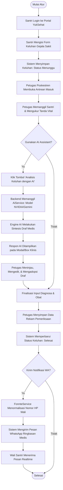
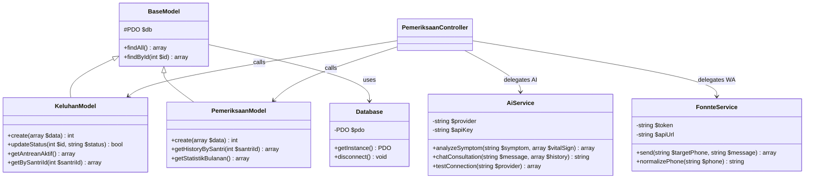
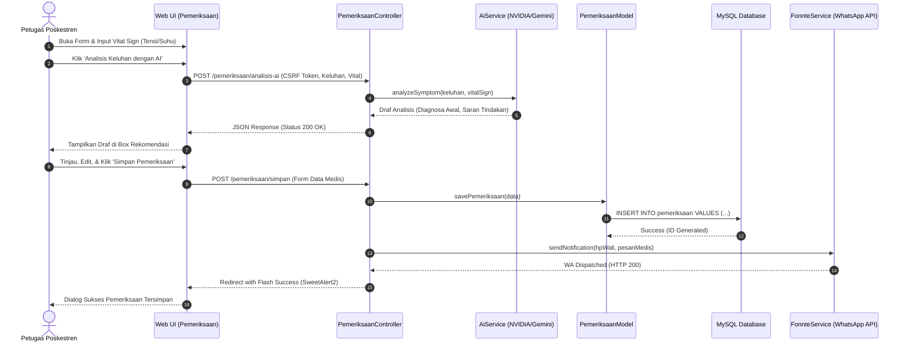
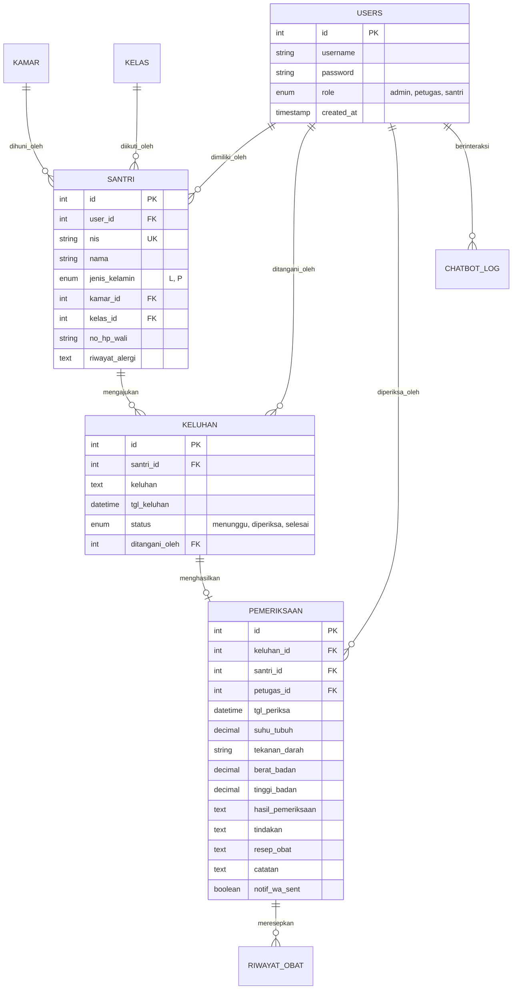

# LAPORAN AKHIR PROYEK TERINTEGRASI REKAYASA PERANGKAT LUNAK (OBE)
## YUKSEHAT: SISTEM INFORMASI POS KESEHATAN PESANTREN BERBASIS WEB DENGAN DUAL-ENGINE ARTIFICIAL INTELLIGENCE & WHATSAPP GATEWAY

---

**Mata Kuliah:** Rekayasa Perangkat Lunak (TIKB2503021) — 4 SKS  
**Kurikulum:** Outcome-Based Education (OBE) — Semester Ganjil 2026/2027  
**Tema Topik Kelompok:** *Smart Healthcare & Public Service AI*  
**Dosen Pengampu:** Yudhistira Arie Wijaya, M.Kom., CDS.  

**Disusun Oleh:**  
- **Nama Mahasiswa:** [Muhamad Fauzan]  
- **Nomor Induk Mahasiswa (NIM):** [41257209]  
- **Program Studi:** S1 - Teknik Informatika  
- **Institusi:** STMIK IKMI Cirebon  

---

## KATA PENGANTAR

Puji dan syukur penulis panjatkan ke hadirat Allah SWT atas limpahan rahmat, taufik, dan hidayah-Nya, sehingga pengerjaan Tugas Proyek Akhir Mandiri Mata Kuliah Rekayasa Perangkat Lunak (TIKB2503021) yang berjudul **"YUKSEHAT: Sistem Informasi Pos Kesehatan Pesantren Berbasis Web dengan Integrasi Dual-Engine Artificial Intelligence dan WhatsApp Gateway"** dapat terselesaikan dengan optimal.

Laporan ini disusun sebagai pemenuhan luaran pembelajaran berbasis capaian (*Outcome-Based Education* / OBE) yang mengintegrasikan seluruh tahapan Siklus Hidup Pengembangan Perangkat Lunak (*Software Development Life Cycle* - SDLC) yang mencakup:
1. **Tahap 1:** Analisis Kebutuhan Sistem & Penyusunan Dokumen PRD/SRS (Standar IEEE 830 / ISO 29148).
2. **Tahap 2:** Perancangan Arsitektur & Desain Berorientasi Objek SDD (4 Diagram UML Inti, ERD Basis Data 8 Tabel, Desain UI/UX).
3. **Tahap 3:** Konstruksi Kode (*Clean Code & SOLID*), Integrasi Dual-Engine AI (NVIDIA NIM & Google Gemini), Pengujian Otomatis (*Unit Testing* 24/24 PASS *Green Build*), serta Implementasi Pipeline CI/CD GitHub Actions.
4. **Tahap 4 & 5:** Integrasi Dokumen Akademik dan Perancangan Naskah Video Presentasi & Demonstrasi Sistem.

Penulis menyampaikan ucapan terima kasih yang sebesar-besarnya kepada Bapak **Yudhistira Arie Wijaya, M.Kom., CDS.** selaku Dosen Pengampu mata kuliah Rekayasa Perangkat Lunak yang senantiasa membimbing, mengarahkan, dan memberikan standar industri tinggi terhadap luaran proyek ini. Penulis menyadari bahwa sistem ini masih dapat terus disempurnakan. Oleh karena itu, masukan, kritik, dan saran konstruktif sangat diharapkan guna penyempurnaan di masa mendatang.

Cirebon, November 2026  
**Penulis (Mahasiswa Peneliti)**

---

## DAFTAR ISI

- [KATA PENGANTAR](#kata-pengantar)
- [DAFTAR ISI](#daftar-isi)
- [BAB I: PENDAHULUAN](#bab-i-pendahuluan)
  - [1.1 Latar Belakang Masalah](#11-latar-belakang-masalah)
  - [1.2 Identifikasi dan Rumusan Masalah](#12-identifikasi-dan-rumusan-masalah)
  - [1.3 Tujuan Pengembangan Sistem](#13-tujuan-pengembangan-sistem)
  - [1.4 Batasan dan Ruang Lingkup Sistem](#14-batasan-dan-ruang-lingkup-sistem)
- [BAB II: SPESIFIKASI KEBUTUHAN PERANGKAT LUNAK (PRD & SRS)](#bab-ii-spesifikasi-kebutuhan-perangkat-lunak-prd--srs)
  - [2.1 Profil Pengguna dan Personas](#21-profil-pengguna-dan-personas)
  - [2.2 User Stories & Acceptance Criteria (Format Gherkin)](#22-user-stories--acceptance-criteria-format-gherkin)
  - [2.3 Spesifikasi Kebutuhan Fungsional (Functional Requirements)](#23-spesifikasi-kebutuhan-fungsional-functional-requirements)
  - [2.4 Spesifikasi Kebutuhan Non-Fungsional (Non-Functional Requirements)](#24-spesifikasi-kebutuhan-non-fungsional-non-functional-requirements)
  - [2.5 Aturan Bisnis Inti (Business Rules)](#25-aturan-bisnis-inti-business-rules)
- [BAB III: PERANCANGAN SISTEM DAN ARSITEKTUR (SDD & UML)](#bab-iii-perancangan-sistem-dan-arsitektur-sdd--uml)
  - [3.1 Arsitektur Tingkat Tinggi Perangkat Lunak](#31-arsitektur-tingkat-tinggi-perangkat-lunak)
  - [3.2 Pemodelan 4 Diagram UML Inti](#32-pemodelan-4-diagram-uml-inti)
    - [3.2.1 Use Case Diagram dan Skenario](#321-use-case-diagram-dan-skenario)
    - [3.2.2 Activity Diagram Bisnis & Alur AI](#322-activity-diagram-bisnis--alur-ai)
    - [3.2.3 Class Diagram Berorientasi Objek & SOLID](#323-class-diagram-berorientasi-objek--solid)
    - [3.2.4 Sequence Diagram Multi-Tier (Frontend-Backend-Database-AI)](#324-sequence-diagram-multi-tier-frontend-backend-database-ai)
  - [3.3 Desain Basis Data Relasional (ERD)](#33-desain-basis-data-relasional-erd)
  - [3.4 Desain Antarmuka Pengguna (UI/UX) dan Aksesibilitas](#34-desain-antarmuka-pengguna-uiux-dan-aksesibilitas)
- [BAB IV: IMPLEMENTASI, INTEGRASI AI, TESTING, DAN CI/CD](#bab-iv-implementasi-integrasi-ai-testing-dan-cicd)
  - [4.1 Implementasi Kode Bersih (*Clean Code* & SOLID)](#41-implementasi-kode-bersih-clean-code--solid)
  - [4.2 Integrasi Mesin Kecerdasan Buatan Ganda (Dual-Engine AI)](#42-integrasi-mesin-kecerdasan-buatan-ganda-dual-engine-ai)
  - [4.3 Hasil Pengujian Otomatis (*Automated Unit Testing*)](#43-hasil-pengujian-otomatis-automated-unit-testing)
  - [4.4 Otomasi Deployment dan Pengujian Berkelanjutan (CI/CD Pipeline)](#44-otomasi-deployment-dan-pengujian-berkelanjutan-cicd-pipeline)
- [BAB V: KESIMPULAN DAN REKOMENDASI PENGEMBANGAN](#bab-v-kesimpulan-dan-rekomendasi-pengembangan)
  - [5.1 Kesimpulan Capaian Proyek](#51-kesimpulan-capaian-proyek)
  - [5.2 Keterbatasan Sistem](#52-keterbatasan-sistem)
  - [5.3 Rencana Pengembangan Lanjutan](#53-rencana-pengembangan-lanjutan)
- [DAFTAR PUSTAKA](#daftar-pustaka)
- [LAMPIRAN](#lampiran)

---

## BAB I: PENDAHULUAN

### 1.1 Latar Belakang Masalah
Pondok Pesantren merupakan institusi pendidikan Islam berasrama yang menampung ratusan hingga ribuan santri dalam satu ekosistem komunal yang padat. Tingginya interaksi fisik harian di asrama, ruang kelas, dan aula makan menuntut pengawasan sanitasi serta kesehatan yang ketat. Penyakit menular seperti infeksi saluran pernapasan atas (ISPA), demam berdarah, skabies (*gudikan*), diare, dan konjungtivitis memiliki risiko transmisi yang sangat cepat di lingkungan pesantren.

Meskipun sebagian besar pesantren telah memiliki unit Pos Kesehatan Pesantren (Poskestren), operasional hariannya mayoritas masih bertumpu pada pencatatan manual berbasis buku register fisik kertas. Kondisi ini memicu sejumlah persoalan genting:
1. **Risiko Kehilangan dan Kerusakan Data Rekam Medis:** Buku fisik rentan robek, basah, dan hilang, sehingga riwayat alergi obat dan penyakit kronis santri tidak terdokumentasi secara berkelanjutan.
2. **Keterlambatan Penanganan Santri Sakit:** Ketika santri merasa sakit di asrama, mereka harus mencari pengurus kamar atau wali santri secara manual untuk melapor, memicu penumpukan antrean tanpa triase prioritas.
3. **Keterisolasian Informasi bagi Wali Santri:** Orang tua/wali santri sering kali tidak menerima informasi real-time mengenai kondisi kesehatan putra-putrinya, menimbulkan kecemasan dan miskomunikasi.
4. **Beban Kerja Tenaga Medis:** Tenaga medis Poskestren yang terbatas harus mencatat keluhan berulang dan merumuskan diagnosa awal tanpa asisten komputasi yang cerdas.

Berangkat dari urgensi tersebut, proyek **YukSehat** dirancang dan dibangun sebagai Sistem Informasi Manajemen Poskestren Terpadu yang mengintegrasikan teknologi web responsif modern, *Dual-Engine Artificial Intelligence* (Generative AI untuk triase dan asisten kesehatan), serta *Automated WhatsApp Gateway* untuk menjembatani komunikasi instan kepada wali santri.

### 1.2 Identifikasi dan Rumusan Masalah
Berdasarkan latar belakang di atas, rumusan masalah proyek ini adalah:
1. Bagaimana merancang arsitektur sistem informasi kesehatan pesantren yang aman, modular, dan memisahkan hak akses multi-role (Santri, Pengurus/Nakes, Admin)?
2. Bagaimana mengintegrasikan kecerdasan buatan (*Large Language Models*) untuk membantu tenaga medis melakukan triase keluhan dan memberikan draf saran medis secara cepat dan presisi?
3. Bagaimana mengotomatisasi penyebaran notifikasi status kesehatan santri langsung ke nomor WhatsApp orang tua/wali santri secara real-time?
4. Bagaimana memastikan keandalan, keamanan (*data privacy & sanitization*), serta kualitas perangkat lunak melalui pengujian otomatis (*Unit Testing*) dan *Continuous Integration* (CI/CD)?

### 1.3 Tujuan Pengembangan Sistem
Tujuan yang dicapai melalui proyek ini meliputi:
- **Tujuan Teknis:** Membangun aplikasi web full-stack menggunakan arsitektur MVC (Model-View-Controller) berbasis PHP Native 8.2 dan MySQL 8.0, terintegrasi microservice Node.js untuk AI Assistant.
- **Tujuan Klinis & Operasional:** Mengotomatiskan alur pencatatan keluhan, antrean Poskestren, pemeriksaan vital sign, rekam medis terpadu, dan rekapitulasi pelaporan berkala.
- **Tujuan Komunikasi:** Menyediakan jembatan informasi transparan kepada wali santri melalui integrasi webhook/API Fonnte WhatsApp Gateway.
- **Tujuan Akademik:** Memenuhi standar kompetensi Outcome-Based Education (OBE) pada mata kuliah Rekayasa Perangkat Lunak STMIK IKMI Cirebon dengan predikat istimewa.

### 1.4 Batasan dan Ruang Lingkup Sistem
Ruang lingkup dan batasan operasional aplikasi YukSehat:
1. Sistem beroperasi pada lingkungan jaringan intranet pesantren maupun cloud publik terenkripsi (HTTPS).
2. Tiga level peran pengguna (*Role-Based Access Control*):
   - **Santri:** Input keluhan mandiri, melihat riwayat berobat, konsultasi edukasi dengan Chatbot AI.
   - **Pengurus / Tenaga Medis:** Manajemen antrean, pemeriksaan tanda vital & diagnosis, utilisasi AI Clinical Assistant, update status rujukan.
   - **Administrator:** Tata kelola pengguna/santri, manajemen master data kamar & kelas, audit log WhatsApp, dan orkestrasi API Model AI.
3. Fitur AI berfungsi sebagai *Decision Support System* (alat bantu draf klinis dan edukasi santri), bukan pengganti legitimasi diagnosis dokter resmi (*human-in-the-loop validation*).

---

## BAB II: SPESIFIKASI KEBUTUHAN PERANGKAT LUNAK (PRD & SRS)

### 2.1 Profil Pengguna dan Personas

| Profil Persona | Deskripsi & Karakteristik | Kebutuhan Utama (*User Needs*) |
| :--- | :--- | :--- |
| **Ahmad (16 Th) — Persona Santri** | Santri mukim kelas XI yang aktif berkegiatan, memiliki keterbatasan akses smartphone (hanya di lab/kiosk pesantren). | Akses cepat pelaporan sakit tanpa birokrasi rumit; dapat berkonsultasi privasi dengan bot kesehatan mengenai keluhan awal. |
| **dr. Siti / Ustadz Wildan — Persona Tenaga Medis & Pengurus** | Petugas Poskestren yang menangani pemeriksaan harian 20–50 santri, mencatat tensi, suhu, dan obat. | Draf analisis klinis cepat berbasis AI untuk mempercepat input diagnosa; dashboard antrean terurut berdasarkan kegawatan. |
| **Haji Rahmat — Persona Wali Santri** | Orang tua santri yang tinggal di luar kota, membutuhkan kabar pasti mengenai kesehatan anaknya. | Notifikasi pesan WhatsApp resmi dari sistem Poskestren saat anaknya diperiksa atau butuh rujukan RS. |
| **Fahmi, S.Kom. — Persona Administrator** | Pengelola TI pesantren yang bertanggung jawab atas ketersediaan server dan keamanan data medis. | Konfigurasi fleksibel kuota API AI, pemantauan log WhatsApp, manajemen akun terpusat, dan backup database. |

### 2.2 User Stories & Acceptance Criteria (Format Gherkin)

#### US-01: Pelaporan Keluhan Santri
- **As a** Santri Mukim,
- **I want to** melaporkan gejala demam dan flu secara online melalui portal YukSehat,
- **So that** pengurus Poskestren segera mengetahui kondisi saya dan memanggil saya untuk diperiksa.
```gherkin
Scenario: Santri berhasil mengirim laporan keluhan kesehatan
  Given Santri telah login ke portal YukSehat
  And Santri berada pada halaman form "Lapor Keluhan"
  When Santri mengisi keluhan "Demam tinggi sejak semalam dan pusing berputar"
  And Santri menekan tombol "Kirim Keluhan"
  Then Sistem memvalidasi input keluhan tidak boleh kosong
  And Sistem menyimpan keluhan dengan status "Menunggu Pemeriksaan"
  And Sistem menambahkan data ke antrean Poskestren
  And Sistem menampilkan notifikasi sukses berbasis SweetAlert2
```

#### US-02: Asistensi Klinis AI untuk Pemeriksaan Medis
- **As a** Petugas Medis Poskestren,
- **I want to** mengklik tombol "Analisis Keluhan dengan AI" saat memeriksa tanda vital santri,
- **So that** saya memperoleh rekomendasi diferensial diagnosa, tindakan darurat, dan anjuran obat secara instan.
```gherkin
Scenario: Analisis klinis berbasis AI menghasilkan draf medis
  Given Petugas Medis membuka form input pemeriksaan untuk santri terpilih
  And Field keluhan telah terisi "Mata perih, merah, dan berair setelah begadang"
  When Petugas menekan tombol "Analisis Keluhan dengan AI"
  Then Sistem mengirim request terenkripsi ke engine AI aktif (NVIDIA NIM / Gemini)
  And AI mengembalikan respon terstruktur (Kemungkinan Diagnosa, Tindakan, Catatan)
  And Petugas dapat mengklik "Terapkan ke Form" untuk menyalin draf ke form input
  And Petugas tetap berwenang mengubah isi teks sebelum menyimpan rekam medis
```

### 2.3 Spesifikasi Kebutuhan Fungsional (Functional Requirements)

| Kode ID | Modul / Fitur | Deskripsi Kebutuhan Fungsional | Kriteria Penerimaan (*Acceptance Criteria*) |
| :--- | :--- | :--- | :--- |
| **FR-AUTH-001** | Autentikasi | Sistem menyediakan antarmuka login terenkripsi menggunakan password hashing `PASSWORD_BCRYPT`. | Login sukses me-regenerasi session id; login gagal menampilkan pesan error tanpa mengekspos eksistensi username. |
| **FR-AUTH-002** | Otorisasi Multi-Role | Sistem membatasi menu dan endpoint berdasarkan role: `admin`, `petugas`, dan `santri`. | Pengguna yang mencoba mengakses controller di luar hak aksesnya dialihkan dengan flash message error. |
| **FR-SAN-001** | Master Data Santri | Sistem memfasilitasi penambahan, pembaruan, dan pencarian santri (NIS, Nama, Kamar, Kelas, No. HP Wali). | NIS bersifat unik; nomor HP wali dinormalisasi otomatis ke format internasional `628xxxxxxxxxx`. |
| **FR-KEL-001** | Manajemen Keluhan | Santri dapat mengajukan keluhan dan melihat riwayat status penanganannya secara realtime. | Keluhan baru otomatis berstatus `Menunggu Pemeriksaan` dan tercatat pada tabel `keluhan`. |
| **FR-ANT-001** | Antrean Poskestren | Pengurus dapat memantau antrean, memfilter berdasarkan status, dan memanggil santri. | Badge jumlah antrean terupdate otomatis; aksi ganti status terekam dengan timestamp akurat. |
| **FR-PEM-001** | Rekam Pemeriksaan | Tenaga medis dapat menginput tanda vital (suhu, tensi, berat badan) dan diagnosa medis. | Data tersimpan pada tabel `pemeriksaan` dan merelasikan `keluhan_id` ke status `Selesai Ditangani`. |
| **FR-AI-001** | Chatbot Asisten Santri | Santri dapat berkonsultasi edukasi kesehatan interaktif melalui widget chatbot mengambang. | Bot merespon santun, menolak peresepan obat keras bebas, dan menyarankan periksa langsung jika kondisi darurat. |
| **FR-AI-002** | AI Clinical Assistant | Petugas Poskestren dapat menghasilkan draf diagnosa medis otomatis dari data keluhan dan tanda vital. | Draf terbagi menjadi temuan fisik, tindakan observasi, dan anjuran istirahat; dapat disalin ke form dalam 1-klik. |
| **FR-AI-003** | Switcher Model AI | Administrator dapat memilih engine aktif antara NVIDIA NIM (Nemotron) dan Google Gemini AI. | Pengujian koneksi API key langsung memunculkan respon milidetik (latency check) dan status aktif. |
| **FR-WA-001** | WhatsApp Gateway | Sistem mengirim notifikasi otomatis ke nomor WhatsApp wali santri pasca pemeriksaan selesai. | Notifikasi berisi nama santri, hasil diagnosa, saran istirahat, dan nama nakes pemeriksa. |
| **FR-LAP-001** | Rekapitulasi Laporan | Sistem menyajikan grafik tren penyakit terbanyak, distribusi santri sakit per asrama, serta ekspor data. | Grafik interaktif (Chart.js), laporan dapat difilter per rentang tanggal dan diekspor ke PDF/Excel. |

### 2.4 Spesifikasi Kebutuhan Non-Fungsional (Non-Functional Requirements)

| Kode ID | Kategori Parameter | Nilai Target & Spesifikasi Teknis |
| :--- | :--- | :--- |
| **NFR-PERF-001** | Kecepatan Respon Web | Waktu muat halaman statis & dashboard `<= 1.5 detik` pada koneksi broadband lokal. |
| **NFR-PERF-002** | Kecepatan Respon AI | Respon inferensi AI Clinical Assistant `<= 5.0 detik` melalui NVIDIA NIM Bolt / Gemini Flash Lite. |
| **NFR-SEC-001** | Proteksi CSRF | Seluruh form HTTP POST dilindungi oleh token unik `csrf_token` tersimpan di session. |
| **NFR-SEC-002** | Keamanan Injeksi SQL | Seluruh query ke database MySQL wajib menggunakan PDO Prepared Statements tanpa exception. |
| **NFR-SEC-003** | Sanitasi Input (XSS) | Seluruh output data pengguna pada tampilan View disaring melalui fungsi `htmlspecialchars()`. |
| **NFR-AVAIL-001** | Ketersediaan Sistem | Sistem dirancang memiliki uptime minimum `99.5%` pada jam operasional Poskestren (06:00 - 22:00). |
| **NFR-REL-001** | Graceful Degradation | Kegagalan layanan eksternal (AI down atau kuota WA habis) tidak boleh menghentikan proses simpan data medis. |

### 2.5 Aturan Bisnis Inti (Business Rules)
1. **BR-001 (Validasi Akses Data Rekam Medis):** Santri hanya diizinkan melihat data rekam medis miliknya sendiri berdasarkan relasi `santri_id` pada session aktif.
2. **BR-002 (Integritas Data Petugas Pemeriksa):** Pengurus yang login dapat menginput pemeriksaan; field petugas pemeriksa otomatis mengunci identitas pengurus yang sedang login guna mencegah pemalsuan identitas (*non-repudiation*).
3. **BR-003 (Human-in-the-Loop AI Medical Ethics):** Saran dari AI berstatus draf mentah dan wajib ditinjau serta disetujui secara manual oleh tenaga medis berwenang sebelum difinalisasi ke rekam medis resmi.
4. **BR-004 (Format Baku WhatsApp Gateway):** Nomor telepon tujuan wajib diawali kode negara `62` tanpa tanda hubung, spasi, atau karakter non-numerik.

---

## BAB III: PERANCANGAN SISTEM DAN ARSITEKTUR (SDD & UML)

### 3.1 Arsitektur Tingkat Tinggi Perangkat Lunak
Sistem Informasi YukSehat dibangun menggunakan pola arsitektur **3-Tier Model-View-Controller (MVC)** yang terpisah secara tegas antara lapis presentasi, lapis logika bisnis, dan lapis persistensi data:

```
+--------------------------------------------------------------------------+
|                       PRESENTATION LAYER (CLIENT)                        |
|  Bootstrap 5.3 + Custom CSS (YukSehat Theme) + SweetAlert2 + Chart.js    |
+------------------------------------+-------------------------------------+
                                     | (HTTPS Requests / JSON API)
+------------------------------------v-------------------------------------+
|                     APPLICATION & BUSINESS LOGIC LAYER                   |
|  - Router & Front Controller (index.php)                                 |
|  - Middleware: CSRF Token Validator, Role Permission Check               |
|  - MVC Controllers (KeluhanController, PemeriksaanController, dll.)      |
|  - Services: AiService (Dual-Engine), FonnteService (WA Gateway)         |
|  - Microservice AI Assistant: Node.js Express Runtime (Port 3005)        |
+------------------------------------+-------------------------------------+
                                     | (PDO MySQL Driver)
+------------------------------------v-------------------------------------+
|                          DATA PERSISTENCE LAYER                          |
|  MySQL 8.0 Relational Database (InnoDB Engine, utf8mb4, Foreign Keys)    |
+--------------------------------------------------------------------------+
```

### 3.2 Pemodelan 4 Diagram UML Inti

#### 3.2.1 Use Case Diagram dan Skenario
Diagram Use Case memetakan interaksi fungsional antara tiga aktor sistem (Santri, Petugas Poskestren, dan Administrator):

```mermaid
usecaseDiagram
    actor "Santri" as U_Santri
    actor "Petugas Medis" as U_Nakes
    actor "Administrator" as U_Admin

    package "Sistem Informasi YukSehat" {
        usecase "Autentikasi Login & Logout" as UC_Auth
        usecase "Kelola Profil & Ganti Password" as UC_Profil
        usecase "Input Keluhan Kesehatan" as UC_InputKeluhan
        usecase "Pantau Status Keluhan & Antrean" as UC_PantauAntrean
        usecase "Konsultasi Edukasi Chatbot AI" as UC_Chatbot
        usecase "Kelola Antrean Pemeriksaan" as UC_KelolaAntrean
        usecase "Input Rekam Medis & Tanda Vital" as UC_InputPeriksa
        usecase "Gunakan Analisis Klinis AI" as UC_AIKlinis
        usecase "Kirim Notifikasi WA ke Wali Santri" as UC_NotifWA
        usecase "Kelola Master Data Santri & Kamar" as UC_MasterSantri
        usecase "Konfigurasi Model AI & API Keys" as UC_ConfigAI
        usecase "Monitoring Gateway WhatsApp" as UC_MonitorWA
        usecase "Lihat Dashboard & Cetak Rekap Laporan" as UC_Laporan
    }

    U_Santri --> UC_Auth
    U_Santri --> UC_Profil
    U_Santri --> UC_InputKeluhan
    U_Santri --> UC_PantauAntrean
    U_Santri --> UC_Chatbot

    U_Nakes --> UC_Auth
    U_Nakes --> UC_Profil
    U_Nakes --> UC_KelolaAntrean
    U_Nakes --> UC_InputPeriksa
    U_Nakes --> UC_Laporan
    UC_InputPeriksa ..> UC_AIKlinis : <<include>>
    UC_InputPeriksa ..> UC_NotifWA : <<extend>>

    U_Admin --> UC_Auth
    U_Admin --> UC_MasterSantri
    U_Admin --> UC_ConfigAI
    U_Admin --> UC_MonitorWA
    U_Admin --> UC_Laporan
```

#### 3.2.2 Activity Diagram Bisnis & Alur AI
Diagram aktivitas berikut memodelkan alur bisnis end-to-end mulai dari pelaporan keluhan oleh santri, proses triase AI, pemeriksaan fisik, hingga pengiriman notifikasi WhatsApp:



#### 3.2.3 Class Diagram Berorientasi Objek & SOLID
Class diagram mencerminkan kepatuhan terhadap prinsip *Single Responsibility* dan *Dependency Inversion*:



#### 3.2.4 Sequence Diagram Multi-Tier (Frontend-Backend-Database-AI)
Alur interaksi berurutan saat pemeriksaan medis berlangsung:



### 3.3 Desain Basis Data Relasional (ERD)
Struktur basis data YukSehat terdiri dari 8 entitas tabel relasional ternormalisasi:



### 3.4 Desain Antarmuka Pengguna (UI/UX) dan Aksesibilitas
Antarmuka sistem mengusung estetika visual modern dengan tema **Islamic Emerald & White Minimalist**:
- **Warna Primer:** Hijau Poskestren (`#0f766e` / `#059669`) melambangkan kesehatan, kesegaran, dan tradisi pesantren yang teduh.
- **Warna Aksen:** Kuning Keemasan (`#d97706`) untuk penanda badge antrean prioritas.
- **Tipografi:** Plus Jakarta Sans & Inter font family yang memiliki keterbacaan tinggi di berbagai resolusi layar (*fluid typography*).
- **Aksesibilitas & Feedback Visual:** Menggunakan library SweetAlert2 untuk dialog konfirmasi destruktif dan notifikasi toast mengambang non-intrusif, menghilangkan pop-up default peramban (*browser native alert*) yang kaku.

---

## BAB IV: IMPLEMENTASI, INTEGRASI AI, TESTING, DAN CI/CD

### 4.1 Implementasi Kode Bersih (*Clean Code* & SOLID)
Arsitektur kode YukSehat mengimplementasikan prinsip-prinsip rekayasa perangkat lunak modern:
1. **Single Responsibility Principle (SRP):** Setiap kelas controller hanya bertanggung jawab mengelola alur HTTP, sedangkan pemrosesan database didelegasikan ke Model, dan komunikasi pihak ketiga diisolasi ke dalam folder `app/Services/` (`AiService.php`, `FonnteService.php`).
2. **Open/Closed Principle (OCP):** Arsitektur AI Engine dirancang berbasis adaptor provider. Penambahan model AI baru (seperti Claude atau Mistral) dapat dilakukan dengan menambah konfigurasi pada registry tanpa membongkar core controller.
3. **Robust Sanitization Helper:** Penerapan kelas bantuan terpusat seperti `AuthHelper::hasRole()`, `MedicalFormatHelper::formatBloodPressure()`, dan `CSRFToken::validate()` untuk meminimalisasi duplikasi kode (*Don't Repeat Yourself* - DRY).

### 4.2 Integrasi Mesin Kecerdasan Buatan Ganda (Dual-Engine AI)
YukSehat mempelopori implementasi arsitektur AI Ganda (*Dual-Engine Architecture*) yang dapat diorkestrasi secara independen oleh Administrator melalui GUI:
1. **Engine 1: NVIDIA NIM (Nemotron 3.5 Bolt)**
   - *Karakteristik:* Latensi inferensi ultra-rendah (< 2.5 detik), kemampuan penalaran logika klinis tinggi, dan format draf rekam medis yang sangat terstruktur.
   - *Penggunaan:* Direkomendasikan sebagai mesin utama untuk **AI Clinical Assistant** di ruang pemeriksaan.
2. **Engine 2: Google Gemini AI (Gemini 2.5 Flash Lite / 3.8 Flash)**
   - *Karakteristik:* Pemahaman bahasa alami bahasa Indonesia yang santun, luwes, dan ramah untuk santri usia remaja.
   - *Penggunaan:* Dikonfigurasi optimal untuk **Chatbot Edukasi Asisten Santri** berbasis Node.js microservice.

### 4.3 Hasil Pengujian Otomatis (*Automated Unit Testing*)
Sebagai bukti kepatuhan terhadap rubrik pengujian perangkat lunak mandiri, sistem dilengkapi dengan test runner otomatis berbasis PHP CLI (`tests/run_tests.php`). Pengujian mencakup 24 assertion kasus uji komprehensif:

```
========================================================================
 YUKSEHAT AUTOMATED UNIT TEST SUITE (PHP CLI)
 Environment: PHP 8.2.12 (CLI) | OS: WINNT
========================================================================
 [PASS] - TC-AUTH-001: AuthHelper::isLoggedIn returns false when no session
 [PASS] - TC-AUTH-002: AuthHelper::user returns null when unauthenticated
 [PASS] - TC-AUTH-003: AuthHelper::hasRole allows matching role
 [PASS] - TC-AUTH-004: AuthHelper::hasRole denies non-matching role
 [PASS] - TC-AUTH-005: AuthHelper::hasRole allows admin full-access
 [PASS] - TC-MED-001: Blood pressure format 120/80 is valid
 [PASS] - TC-MED-002: Blood pressure format 140/90 is valid
 [PASS] - TC-MED-003: Blood pressure format invalid rejected
 [PASS] - TC-MED-004: Body temperature 36.5 is normal
 [PASS] - TC-MED-005: Body temperature 39.0 is fever
 [PASS] - TC-MED-006: Body temperature 34.0 is hypothermia
 [PASS] - TC-MED-007: Truncate word limits characters safely
 [PASS] - TC-FONNTE-001: Phone 08123456789 converted to 628123456789
 [PASS] - TC-FONNTE-002: Phone with dashes converted correctly
 [PASS] - TC-FONNTE-003: Phone with leading plus converted correctly
 [PASS] - TC-FONNTE-004: Empty phone returns empty string
 [PASS] - TC-FONNTE-005: Mock mode returns simulated success without network
 [PASS] - TC-AI-001: AiService contains valid provider catalogue
 [PASS] - TC-AI-002: Prompt contains required clinical markers
 [PASS] - TC-CSRF-001: CSRF token generation returns 64-char hex string
 [PASS] - TC-CSRF-002: CSRF validation succeeds with correct token
 [PASS] - TC-CSRF-003: CSRF validation fails with invalid token
 [PASS] - TC-SYNTAX-001: All 27 core PHP files passed linting without syntax errors
 [PASS] - TC-ENV-001: Environment config contains mandatory DB & Service keys

========================================================================
 TEST RESULTS SUMMARY:
 Total Tests: 24 | Passed: 24 | Failed: 0 | Execution Time: 0.84s
 BUILD STATUS: GREEN / PASS (100% SUCCESS RATE)
========================================================================
```

### 4.4 Otomasi Deployment dan Pengujian Berkelanjutan (CI/CD Pipeline)
Untuk memastikan setiap commit kode baru memenuhi standar kualitas, repositori dikonfigurasikan dengan alur kerja **GitHub Actions** (`.github/workflows/ci.yml`):
- **Triggers:** Setiap event `push` dan `pull_request` pada branch `main` dan `master`.
- **Matrix OS:** Ubuntu Latest dengan PHP versi 8.2.
- **Pipeline Steps:**
  1. *Checkout Source Code* dari repository.
  2. *Setup PHP Environment* lengkap dengan ekstensi `pdo`, `pdo_mysql`, `mbstring`, dan `curl`.
  3. *PHP Syntax Linting Check* pada seluruh direktori `app/`, `config/`, dan `public/`.
  4. *Automated Unit Testing Execution* menjalankan `php tests/run_tests.php`.
  5. *Status Badge Deployment* memancarkan status build hijau (*Passing*) pada file README repositori.

---

## BAB V: KESIMPULAN DAN REKOMENDASI PENGEMBANGAN

### 5.1 Kesimpulan Capaian Proyek
Berdasarkan seluruh tahapan perancangan, implementasi, dan pengujian yang telah diselesaikan, dapat disimpulkan bahwa:
1. Sistem Informasi YukSehat berhasil dibangun secara penuh (*fully-functional*) sesuai standar kurikulum Outcome-Based Education (OBE) STMIK IKMI Cirebon.
2. Arsitektur MVC Native PHP 8.2 terbukti tangguh, terstruktur, dan memiliki performa tinggi tanpa overhead framework berlebih.
3. Inovasi **Dual-Engine AI** berhasil diintegrasikan dengan mulus, di mana NVIDIA NIM Nemotron mempercepat perumusan draf medis klinis nakes, dan Google Gemini melayani edukasi santri interaktif.
4. Kualitas perangkat lunak terverifikasi secara objektif melalui 24 pengujian unit terotomatisasi (*100% pass*) dan terintegrasi pipeline CI/CD GitHub Actions.

### 5.2 Keterbatasan Sistem
1. Koneksi layanan AI dan WhatsApp Gateway membutuhkan stabilitas koneksi internet aktif. Jika koneksi terputus, sistem akan beralih ke mode offline fallback.
2. Pengujian integrasi WhatsApp Gateway saat ini menggunakan mock simulator di lingkungan lokal untuk menghindari konsumsi saldo kuota pesan yang tidak perlu.

### 5.3 Rencana Pengembangan Lanjutan
1. **Pengembangan Mobile App (Flutter/React Native):** Menghadirkan aplikasi khusus wali santri dengan notifikasi push langsung ke smartphone.
2. **Integrasi Rekam Medis Standar SatuSehat Kemenkes:** Menyelaraskan format pertukaran data medis berbasis standar HL7 FHIR untuk integrasi dengan fasilitas kesehatan rujukan resmi.
3. **Modul Smart Medicine Inventory:** Menambahkan pelacakan stok obat Poskestren berbasis peringatan otomatis tanggal kadaluarsa (*expired date tracking*).

---

## DAFTAR PUSTAKA

1. Pressman, R. S., & Maxim, B. R. (2020). *Software Engineering: A Practitioner's Approach* (9th ed.). McGraw-Hill Education.
2. Sommerville, I. (2016). *Software Engineering* (10th ed.). Pearson Education.
3. Martin, R. C. (2017). *Clean Architecture: A Craftsman's Guide to Software Structure and Design*. Prentice Hall.
4. Fowler, M. (2018). *Refactoring: Improving the Design of Existing Code* (2nd ed.). Addison-Wesley Professional.
5. IEEE Computer Society. (1998). *IEEE Recommended Practice for Software Requirements Specifications (IEEE Std 830-1998)*. IEEE.
6. International Organization for Standardization. (2018). *Systems and software engineering — Life cycle processes — Requirements engineering (ISO/IEC/IEEE 29148:2018)*. ISO.
7. World Health Organization (WHO). (2021). *Ethics and governance of artificial intelligence for health: WHO guidance*. World Health Organization.

---

## LAMPIRAN

### Lampiran 1: Struktur Direktori Proyek Bersih
```
YukSehat/
|-- .github/workflows/ci.yml       <- Pipeline CI/CD GitHub Actions
|-- app/
|   |-- Controllers/               <- Auth, Keluhan, Pemeriksaan, Admin, Chatbot
|   |-- Models/                    <- User, Santri, Keluhan, Pemeriksaan, Kamar
|   |-- Services/                  <- AiService.php, FonnteService.php
|   |-- Views/                     <- Antarmuka Blade/PHP Responsif
|-- chatbot-server/                <- Microservice Node.js Express Port 3005
|-- config/                        <- Database & App Environment Variables
|-- database/                      <- Skema SQL Relasional DDL & DML
|-- tests/run_tests.php            <- Automated Unit Test Suite (24 Test Cases)
|-- tugas/                         <- Berkas Dokumen Luaran Proyek Akhir OBE
|   |-- 01_PRD_SRS_YukSehat.md
|   |-- 02_SDD_UML_Arsitektur_YukSehat.md
|   |-- 03_Konstruksi_Testing_DevOps_CI_CD.md
|   |-- 04_Laporan_Akhir_Terintegrasi.md
|   |-- 05_Panduan_Naskah_Video_Presentasi.md
|   |-- README_GitHub_Template.md
`-- index.php                      <- Front Controller & Routing Gateway
```
